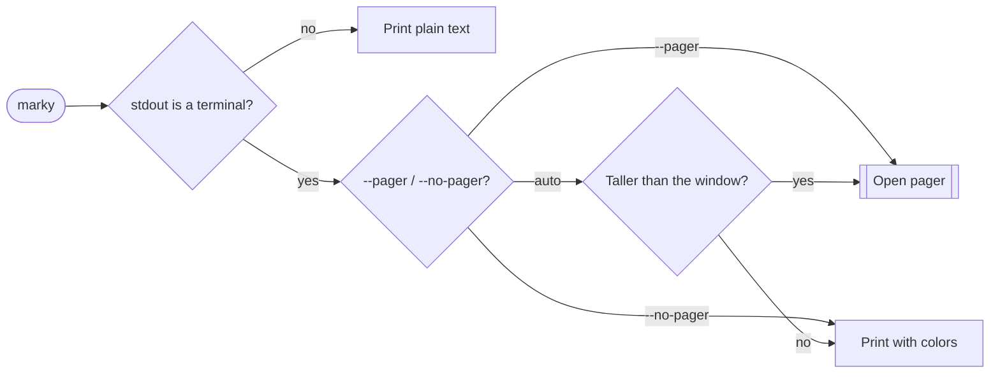

<div align="center">

# 📝 marky

### Beautiful Markdown, right in your terminal.

Clean typography, zero syntax noise, and a smooth pager for long docs.

  

[Install](#-install) · [Usage](#-usage) · [Features](#-features) · [Replace cat](#-use-it-as-cat) · [Development](#-development)

**English** · [Português](README.pt-BR.md)


<sub>Rendering <code>docs/demo.md</code> with the dark theme.</sub>

</div>

---

## ✨ Why marky?

<table>
<tr>
<td width="50%" valign="top">

🧼 **No syntax noise**<br>
No `#`, `*`, `` ` `` or `>` on screen. Structure comes from color and typography.

</td>
<td width="50%" valign="top">

🎨 **Modern theme**<br>
Catppuccin Mocha on dark terminals, Latte on light ones. Code blocks get matching syntax highlighting.

</td>
</tr>
<tr>
<td width="50%" valign="top">

📐 **Fits your window**<br>
Wraps to the terminal width, capped at a comfortable 100 columns and centered.

</td>
<td width="50%" valign="top">

📜 **Built-in pager**<br>
Long docs open in a `less`-style viewer with a progress bar. Press `q` to leave.

</td>
</tr>
<tr>
<td width="50%" valign="top">

🔁 **Resize-aware**<br>
Re-wraps live when the window changes and keeps your place.

</td>
<td width="50%" valign="top">

🧩 **Pipe-friendly**<br>
Plain, escape-free text when stdout is not a terminal.

</td>
</tr>
</table>

## 📦 Install

With Go 1.26 or newer:

```sh
go install github.com/silviohfc/marky@latest
```

Or build from source:

```sh
git clone https://github.com/silviohfc/marky && cd marky
go build -o marky .
```

## 🚀 Usage

```sh
marky README.md                      # render a file
cat CHANGELOG.md | marky             # render from a pipe
marky --style light --width 72 a.md  # pick theme and width
marky --pager notes.md               # always open the viewer
marky --no-pager notes.md > out.txt  # plain text, no colors
```

> [!TIP]
> With no file, marky reads piped input. If nothing is piped, it shows the help instead of waiting. Use `-` to type Markdown by hand and finish with <kbd>Ctrl</kbd>+<kbd>D</kbd>.

### Flags

| Flag | Default | Description |
|:-----|:-------:|:------------|
| `--style` | `auto` | `dark`, `light` or `auto` (detects the terminal background). |
| `--width N` | terminal | Wrap width in columns. Capped at 100 on a TTY, 80 otherwise. |
| `--pager` |  | Always open the interactive viewer. |
| `--no-pager` |  | Always print, never open the viewer. |
| `--version` |  | Print the version. |
| `-h`, `--help` |  | Show the help. |

## 🧭 Features

### When does the pager open?



### Pager keys

| Keys | Action |
|:-----|:-------|
| <kbd>q</kbd> <kbd>Esc</kbd> <kbd>Ctrl</kbd>+<kbd>C</kbd> | Quit |
| <kbd>j</kbd> <kbd>k</kbd> <kbd>↓</kbd> <kbd>↑</kbd> | Scroll one line |
| <kbd>Space</kbd> <kbd>f</kbd> <kbd>PgDn</kbd> · <kbd>b</kbd> <kbd>PgUp</kbd> | Page down · up |
| <kbd>d</kbd> · <kbd>u</kbd> | Half page down · up |
| <kbd>g</kbd> <kbd>Home</kbd> · <kbd>G</kbd> <kbd>End</kbd> | Top · bottom |
| 🖱️ wheel | Scroll |

The footer shows the file name, key hints, a progress bar and the percentage read. The viewer uses the alternate screen, so your terminal comes back untouched.

## 🐱 Use it as `cat`

Make `cat README.md` render beautifully, while `cat` keeps working everywhere else. The wrapper calls marky only when **every argument is an existing `.md`/`.markdown` file and the output is a terminal**. Everything else (other files, `-n`, pipes, redirects) goes to the real `cat`.

Pick your shell, paste the snippet into its config file, then reload it:

<details open>
<summary><b>Bash</b> · <code>~/.bashrc</code></summary>

```bash
cat() {
  if [ -t 1 ] && [ "$#" -gt 0 ]; then
    for arg in "$@"; do
      case "$arg" in
        *.md|*.markdown) [ -f "$arg" ] || { command cat "$@"; return; } ;;
        *) command cat "$@"; return ;;
      esac
    done
    command marky "$@"
  else
    command cat "$@"
  fi
}
```

Reload: `source ~/.bashrc`

</details>

<details>
<summary><b>Zsh</b> · <code>~/.zshrc</code></summary>

```zsh
cat() {
  if [ -t 1 ] && [ "$#" -gt 0 ]; then
    for arg in "$@"; do
      case "$arg" in
        *.md|*.markdown) [ -f "$arg" ] || { command cat "$@"; return; } ;;
        *) command cat "$@"; return ;;
      esac
    done
    command marky "$@"
  else
    command cat "$@"
  fi
}
```

Reload: `source ~/.zshrc`

</details>

<details>
<summary><b>Fish</b> · <code>~/.config/fish/functions/cat.fish</code></summary>

```fish
function cat --wraps cat --description 'cat, with marky for Markdown files'
    if isatty stdout; and test (count $argv) -gt 0
        for arg in $argv
            if not string match -rq '\.(md|markdown)$' -- $arg; or not test -f $arg
                command cat $argv
                return $status
            end
        end
        command marky $argv
    else
        command cat $argv
    end
end
```

Reload: `source ~/.config/fish/config.fish`

</details>

<details>
<summary><b>PowerShell</b> · <code>$PROFILE</code></summary>

```powershell
Remove-Item Alias:cat -Force -ErrorAction SilentlyContinue
function cat {
    $notMarkdown = $args | Where-Object {
        $_ -notmatch '\.(md|markdown)$' -or -not (Test-Path -LiteralPath $_ -PathType Leaf)
    }
    if ($args.Count -gt 0 -and -not $notMarkdown -and -not [Console]::IsOutputRedirected) {
        marky @args
    } else {
        Get-Content @args
    }
}
```

Reload: `. $PROFILE`

</details>

<details>
<summary><b>Nushell</b> · <code>config.nu</code></summary>

```nu
def --wrapped cat [...args: string] {
    let all_markdown = ($args | is-not-empty) and ($args | all {|a|
        ($a =~ '\.(md|markdown)$') and (($a | path type) == 'file')
    })
    if $all_markdown and (is-terminal --stdout) {
        ^marky ...$args
    } else {
        ^cat ...$args
    }
}
```

Reload: `restart nu`

</details>

<details>
<summary><b>POSIX sh · dash · ksh</b> · <code>~/.profile</code></summary>

```sh
cat() {
  if [ -t 1 ] && [ "$#" -gt 0 ]; then
    for arg in "$@"; do
      case "$arg" in
        *.md|*.markdown) [ -f "$arg" ] || { command cat "$@"; return; } ;;
        *) command cat "$@"; return ;;
      esac
    done
    command marky "$@"
  else
    command cat "$@"
  fi
}
```

Reload: `. ~/.profile`

</details>

<details>
<summary><b>Just want a plain alias?</b></summary>

> [!WARNING]
> An alias sends <i>everything</i> through marky: `cat -n file`, `cat a.txt b.txt` and `cat file | less` will all be rendered as Markdown. Prefer the wrapper.

| Shell | Alias |
|:------|:------|
| Bash / Zsh / sh | `alias cat=marky` |
| Fish | `alias cat marky` |
| PowerShell | `Set-Alias -Name cat -Value marky -Option AllScope -Force` |
| Nushell | `alias cat = marky` |

</details>

> [!NOTE]
> - Aliases and functions only affect **interactive** shells. Scripts, `make` and cron still use the real `cat`.
> - Skip the wrapper once: `command cat file.md` or `\cat file.md` (POSIX shells), `Get-Content file.md` (PowerShell), `^cat file.md` (Nushell).
> - The PowerShell and Nushell snippets follow each shell's documented syntax but were not run on the author's machine. Issues welcome.

## 🛠️ Development

```sh
go vet ./...
go test ./...
```

Try it with the sample documents:

```sh
go run . testdata/sample.md
go run . docs/demo.md
```

<details>
<summary>Project layout</summary>

```text
marky/
├── main.go           # wiring: TTY detection, terminal size, program start
├── internal/cli/     # flags, input selection and the pager decision
├── internal/render/  # glamour renderer, theme, width and centering
├── internal/pager/   # bubbletea viewer and footer
├── docs/             # demo document and screenshot
└── testdata/         # sample covering every Markdown element
```

</details>

<details>
<summary>Regenerating the screenshot</summary>

The image is made with [freeze](https://github.com/charmbracelet/freeze) from marky's real output at 76 columns:

```sh
script -q /dev/null sh -c 'stty cols 76; marky --no-pager --style dark docs/demo.md' > demo.ansi
freeze demo.ansi --language ansi --window --theme catppuccin-mocha \
  --background "#1E1E2E" --border.radius 10 --border.width 1 --border.color "#45475A" \
  --shadow.blur 20 --shadow.y 10 --padding "24,32" --margin 24 \
  --font.family "JetBrains Mono" --font.size 14 --line-height 1.4 \
  -o docs/screenshot.png
```

Strip the terminal's query sequences and control characters (`^D`) from `demo.ansi` before running `freeze`.

</details>

---

<div align="center">
<sub>Built with 💜 on top of [Glamour](https://github.com/charmbracelet/glamour), [Bubble Tea](https://github.com/charmbracelet/bubbletea) and [Lip Gloss](https://github.com/charmbracelet/lipgloss).</sub>
</div>
