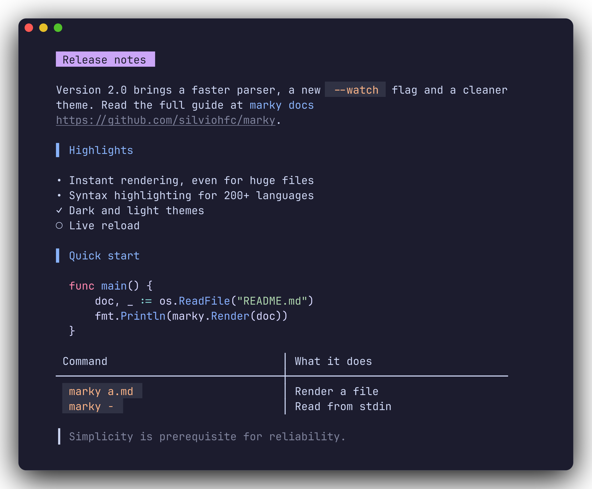
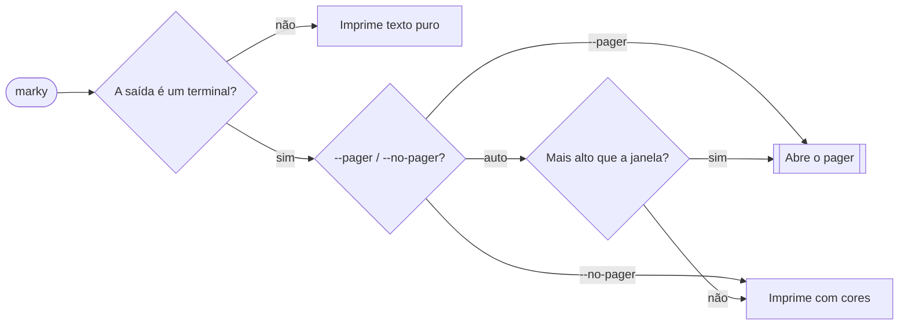

<div align="center">

# 📝 marky

### Markdown bonito, direto no seu terminal.

Tipografia limpa, zero ruído de sintaxe e um pager suave para documentos longos.

  

[Instalação](#-instalação) · [Uso](#-uso) · [Recursos](#-recursos) · [Substituir o cat](#-use-como-cat) · [Desenvolvimento](#-desenvolvimento)

[English](README.md) · **Português**



<sub>Renderizando <code>docs/demo.md</code> com o tema escuro.</sub>

</div>

---

## ✨ Por que o marky?

<table>
<tr>
<td width="50%" valign="top">

🧼 **Sem ruído de sintaxe**<br>
Nada de `#`, `*`, `` ` `` ou `>` na tela. A estrutura vem das cores e da tipografia.

</td>
<td width="50%" valign="top">

🎨 **Tema moderno**<br>
Catppuccin Mocha em terminais escuros, Latte nos claros. Blocos de código com realce de sintaxe combinando.

</td>
</tr>
<tr>
<td width="50%" valign="top">

📐 **Cabe na sua janela**<br>
Quebra as linhas conforme a largura do terminal, até 100 colunas confortáveis, e centraliza.

</td>
<td width="50%" valign="top">

📜 **Pager embutido**<br>
Documentos longos abrem num visualizador estilo `less` com barra de progresso. Aperte `q` para sair.

</td>
</tr>
<tr>
<td width="50%" valign="top">

🔁 **Acompanha o redimensionamento**<br>
Requebra o texto ao vivo quando a janela muda e mantém sua posição.

</td>
<td width="50%" valign="top">

🧩 **Amigo de pipes**<br>
Texto puro, sem códigos de escape, quando a saída não é um terminal.

</td>
</tr>
</table>

## 📦 Instalação

Com Go 1.26 ou mais recente:

```sh
go install github.com/silviohfc/marky@latest
```

Ou compile a partir do código:

```sh
git clone https://github.com/silviohfc/marky && cd marky
go build -o marky .
```

## 🚀 Uso

```sh
marky README.md                      # renderiza um arquivo
cat CHANGELOG.md | marky             # renderiza vindo de um pipe
marky --style light --width 72 a.md  # escolhe tema e largura
marky --pager notes.md               # sempre abre o visualizador
marky --no-pager notes.md > out.txt  # texto puro, sem cores
```

> [!TIP]
> Sem arquivo, o marky lê o que chega por pipe. Se nada chegar, ele mostra a ajuda em vez de ficar esperando. Use `-` para digitar Markdown na mão e finalize com <kbd>Ctrl</kbd>+<kbd>D</kbd>.

### Opções

| Opção | Padrão | Descrição |
|:------|:------:|:----------|
| `--style` | `auto` | `dark`, `light` ou `auto` (detecta o fundo do terminal). |
| `--width N` | terminal | Largura de quebra em colunas. Máximo de 100 num TTY, 80 fora dele. |
| `--pager` |  | Sempre abre o visualizador interativo. |
| `--no-pager` |  | Sempre imprime, nunca abre o visualizador. |
| `--version` |  | Mostra a versão. |
| `-h`, `--help` |  | Mostra a ajuda. |

## 🧭 Recursos

### Quando o pager abre?



### Teclas do pager

| Teclas | Ação |
|:-------|:-----|
| <kbd>q</kbd> <kbd>Esc</kbd> <kbd>Ctrl</kbd>+<kbd>C</kbd> | Sair |
| <kbd>j</kbd> <kbd>k</kbd> <kbd>↓</kbd> <kbd>↑</kbd> | Rolar uma linha |
| <kbd>Space</kbd> <kbd>f</kbd> <kbd>PgDn</kbd> · <kbd>b</kbd> <kbd>PgUp</kbd> | Página abaixo · acima |
| <kbd>d</kbd> · <kbd>u</kbd> | Meia página abaixo · acima |
| <kbd>g</kbd> <kbd>Home</kbd> · <kbd>G</kbd> <kbd>End</kbd> | Início · fim |
| 🖱️ roda do mouse | Rolar |

O rodapé mostra o nome do arquivo, dicas de teclas, uma barra de progresso e a porcentagem lida. O visualizador usa a tela alternativa, então seu terminal volta intacto.

## 🐱 Use como `cat`

Faça o `cat README.md` renderizar bonito, enquanto o `cat` continua funcionando normalmente no resto. A função chama o marky só quando **todos os argumentos são arquivos `.md`/`.markdown` existentes e a saída é um terminal**. O resto (outros arquivos, `-n`, pipes, redirecionamentos) vai para o `cat` de verdade.

Escolha seu shell, cole o trecho no arquivo de configuração e recarregue:

<details open>
<summary><b>Bash</b> · <code>~/.bashrc</code></summary>

```bash
cat() {
  if [ -t 1 ] && [ "$#" -gt 0 ]; then
    for arg in "$@"; do
      case "$arg" in
        *.md|*.markdown) [ -f "$arg" ] || { command cat "$@"; return; } ;;
        *) command cat "$@"; return ;;
      esac
    done
    command marky "$@"
  else
    command cat "$@"
  fi
}
```

Recarregar: `source ~/.bashrc`

</details>

<details>
<summary><b>Zsh</b> · <code>~/.zshrc</code></summary>

```zsh
cat() {
  if [ -t 1 ] && [ "$#" -gt 0 ]; then
    for arg in "$@"; do
      case "$arg" in
        *.md|*.markdown) [ -f "$arg" ] || { command cat "$@"; return; } ;;
        *) command cat "$@"; return ;;
      esac
    done
    command marky "$@"
  else
    command cat "$@"
  fi
}
```

Recarregar: `source ~/.zshrc`

</details>

<details>
<summary><b>Fish</b> · <code>~/.config/fish/functions/cat.fish</code></summary>

```fish
function cat --wraps cat --description 'cat, with marky for Markdown files'
    if isatty stdout; and test (count $argv) -gt 0
        for arg in $argv
            if not string match -rq '\.(md|markdown)$' -- $arg; or not test -f $arg
                command cat $argv
                return $status
            end
        end
        command marky $argv
    else
        command cat $argv
    end
end
```

Recarregar: `source ~/.config/fish/config.fish`

</details>

<details>
<summary><b>PowerShell</b> · <code>$PROFILE</code></summary>

```powershell
Remove-Item Alias:cat -Force -ErrorAction SilentlyContinue
function cat {
    $notMarkdown = $args | Where-Object {
        $_ -notmatch '\.(md|markdown)$' -or -not (Test-Path -LiteralPath $_ -PathType Leaf)
    }
    if ($args.Count -gt 0 -and -not $notMarkdown -and -not [Console]::IsOutputRedirected) {
        marky @args
    } else {
        Get-Content @args
    }
}
```

Recarregar: `. $PROFILE`

</details>

<details>
<summary><b>Nushell</b> · <code>config.nu</code></summary>

```nu
def --wrapped cat [...args: string] {
    let all_markdown = ($args | is-not-empty) and ($args | all {|a|
        ($a =~ '\.(md|markdown)$') and (($a | path type) == 'file')
    })
    if $all_markdown and (is-terminal --stdout) {
        ^marky ...$args
    } else {
        ^cat ...$args
    }
}
```

Recarregar: `restart nu`

</details>

<details>
<summary><b>POSIX sh · dash · ksh</b> · <code>~/.profile</code></summary>

```sh
cat() {
  if [ -t 1 ] && [ "$#" -gt 0 ]; then
    for arg in "$@"; do
      case "$arg" in
        *.md|*.markdown) [ -f "$arg" ] || { command cat "$@"; return; } ;;
        *) command cat "$@"; return ;;
      esac
    done
    command marky "$@"
  else
    command cat "$@"
  fi
}
```

Recarregar: `. ~/.profile`

</details>

<details>
<summary><b>Quer só um alias simples?</b></summary>

> [!WARNING]
> Um alias manda <i>tudo</i> para o marky: `cat -n arquivo`, `cat a.txt b.txt` e `cat arquivo | less` serão renderizados como Markdown. Prefira a função.

| Shell | Alias |
|:------|:------|
| Bash / Zsh / sh | `alias cat=marky` |
| Fish | `alias cat marky` |
| PowerShell | `Set-Alias -Name cat -Value marky -Option AllScope -Force` |
| Nushell | `alias cat = marky` |

</details>

> [!NOTE]
> - Aliases e funções só afetam shells **interativos**. Scripts, `make` e cron continuam usando o `cat` de verdade.
> - Pule a função uma vez: `command cat arquivo.md` ou `\cat arquivo.md` (shells POSIX), `Get-Content arquivo.md` (PowerShell), `^cat arquivo.md` (Nushell).
> - Os trechos de PowerShell e Nushell seguem a sintaxe documentada de cada shell, mas não foram executados na máquina do autor. Issues são bem-vindas.

## 🛠️ Desenvolvimento

```sh
go vet ./...
go test ./...
```

Teste com os documentos de exemplo:

```sh
go run . testdata/sample.md
go run . docs/demo.md
```

<details>
<summary>Estrutura do projeto</summary>

```text
marky/
├── main.go           # montagem: detecção de TTY, tamanho do terminal, início do programa
├── internal/cli/     # opções, escolha da entrada e decisão do pager
├── internal/render/  # renderizador glamour, tema, largura e centralização
├── internal/pager/   # visualizador bubbletea e rodapé
├── docs/             # documento de demonstração e screenshot
└── testdata/         # exemplo com todos os elementos de Markdown
```

</details>

<details>
<summary>Gerando o screenshot de novo</summary>

A imagem é feita com o [freeze](https://github.com/charmbracelet/freeze) a partir da saída real do marky em 76 colunas:

```sh
script -q /dev/null sh -c 'stty cols 76; marky --no-pager --style dark docs/demo.md' > demo.ansi
freeze demo.ansi --language ansi --window --theme catppuccin-mocha \
  --background "#1E1E2E" --border.radius 10 --border.width 1 --border.color "#45475A" \
  --shadow.blur 20 --shadow.y 10 --padding "24,32" --margin 24 \
  --font.family "JetBrains Mono" --font.size 14 --line-height 1.4 \
  -o docs/screenshot.png
```

Strip the terminal's query sequences and control characters (`^D`) from `demo.ansi` before running `freeze`.

</details>

---

<div align="center">
<sub>Feito com 💜 em cima de [Glamour](https://github.com/charmbracelet/glamour), [Bubble Tea](https://github.com/charmbracelet/bubbletea) e [Lip Gloss](https://github.com/charmbracelet/lipgloss).</sub>
</div>
